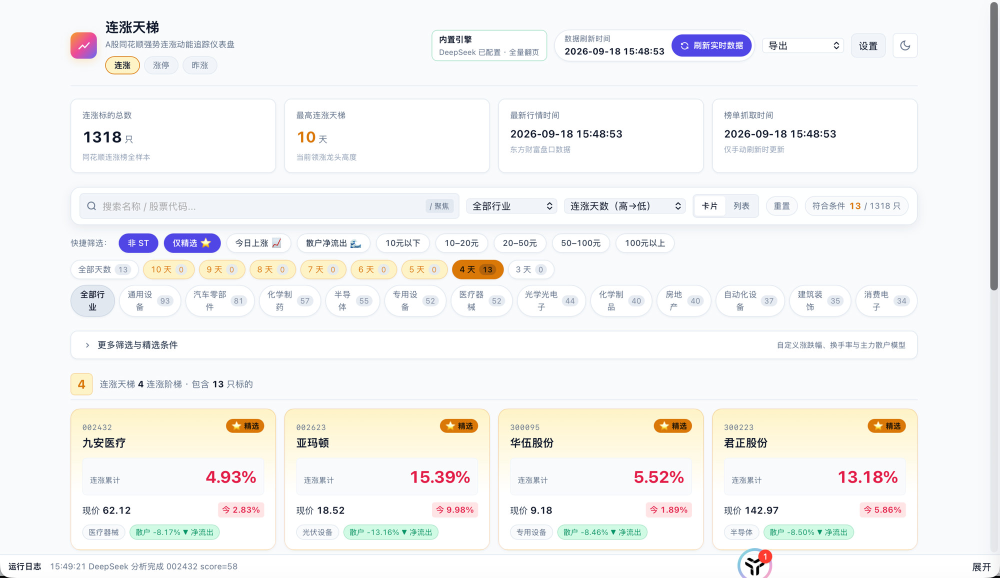
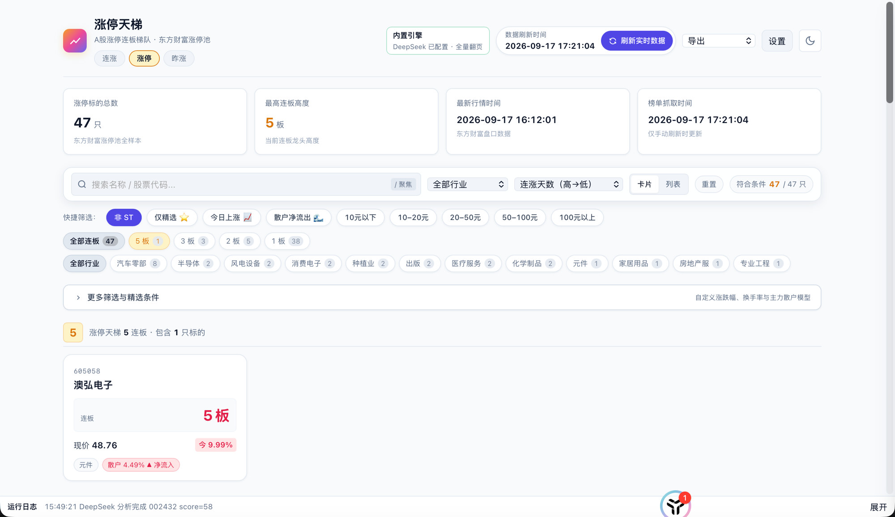
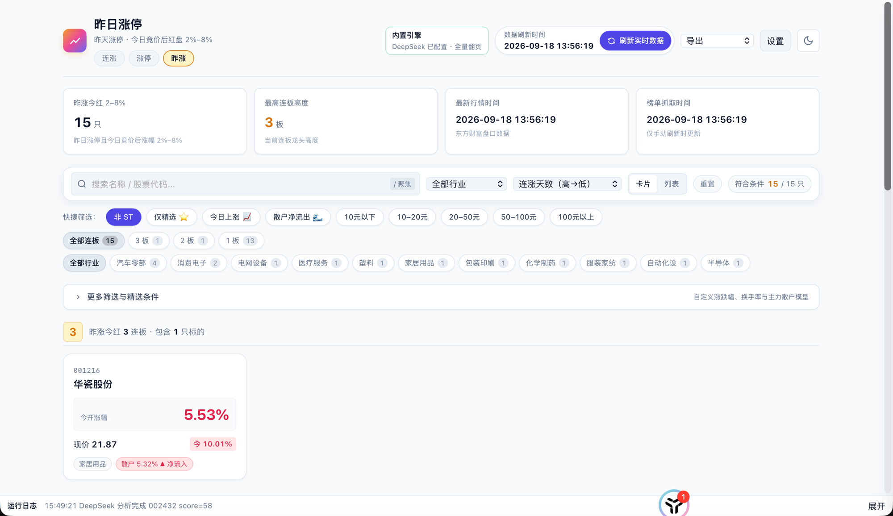
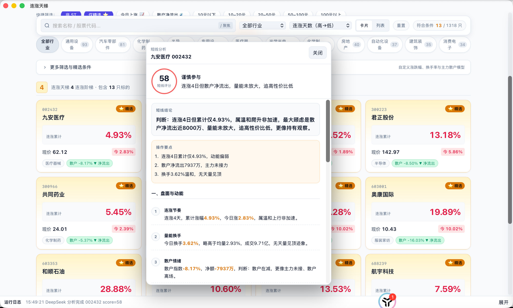

# 连涨天梯（gp-ladder）

[](https://github.com/uasier/gp-ladder/releases)
[](LICENSE)
[](https://github.com/uasier/gp-ladder/releases)

开源的 A 股**连涨榜 / 涨停天梯 / 昨日涨停**工作台（macOS · Windows · Android）。从同花顺抓取连续上涨榜，叠加东方财富当日行情（现价、涨跌幅、今开高低、换手、成交额、市盈率、散户资金），在窗口里筛选、精选并导出。

Tonghuashun consecutive-gain rankings, East Money limit-up boards, and yesterday’s limit-up watchlist — a local A-share desktop / Android app.

安装包见 [下载官网](https://gp.uasier.com/#download) 或 [GitHub Releases](https://github.com/uasier/gp-ladder/releases)。官网：[gp.uasier.com](https://gp.uasier.com/)

抓取在软件内部完成，不依赖本机 Python、uv 或仓库脚本。打开只读本地快照；点击「刷新实时数据」才会联网。

**本项目仅供学习交流**，不构成任何投资建议。详见文末[免责说明](#免责说明)。

## 下载

从 [GitHub Releases](https://github.com/uasier/gp-ladder/releases) 获取安装包：

- macOS：`gp-ladder_*_aarch64.dmg`（Apple Silicon）/ `gp-ladder_*_x64.dmg`（Intel）
- Windows：`gp-ladder_*_x64-setup.exe`（未签名，SmartScreen 可能提示「仍要运行」）
- Android：`gp-ladder_*_aarch64.apk`（未签名，需允许「安装未知来源」）

应用内 **设置 → 关于** 可检查更新，并下载当前系统对应的安装包。

### macOS 提示「文件已损坏」

安装包没有 Apple 开发者公证。macOS 15 及以后（系统升级后尤其明显）会把这种情况显示成「已损坏，无法打开」，**不是**下载坏了。把「连涨天梯」拖进「应用程序」后，在「终端」执行：

```bash
xattr -cr /Applications/连涨天梯.app
codesign --force --deep --sign - /Applications/连涨天梯.app
open /Applications/连涨天梯.app
```

旧系统上的「右键 → 打开」在新系统上已经无效。`xattr` 去掉浏览器下载带来的隔离标记；`codesign` 给整个 `.app` 补上临时签名（v0.2.0 包里只有链接器签过可执行文件，Gatekeeper 会当成损坏）。

## 界面预览

**连涨天梯** — 同花顺连涨榜叠加东方财富行情，按天数、行业、精选筛选。



**涨停天梯** — 东方财富涨停池，按连板高度分档。



**昨日涨停** — 昨天涨停，今日竞价后红盘且涨幅 2%–8%。



**DeepSeek 短线分析** — 右键个股，按 1–5 个交易日视角看盘，并给出 0–100 短线评分。



## 环境

日常改前端只需 **Node 18+**。

Rust / Android / 安装包编译都在 GitHub Actions 上完成，不必在本机装 JDK、Android SDK 或交叉编译 target。`npm run tauri:build` 会转到云端，不会在本机生成数 GB 的 `src-tauri/target/`。

## 开发

```bash
npm install
npm test          # 前端单测（本机）
npm run dev       # 仅 Vite，不编译 Rust
```

全平台安装包（macOS arm64 / macOS x64 / Windows / Android APK）只在 GitHub 上编译：

```bash
npm run build:github
# 等同 npm run tauri:build / tauri:build:mac / tauri:build:win / tauri:android:build
# 或打开 Actions → Build → Run workflow
# 填已有 tag（如 v0.2.0）会把安装包挂到该 Release；留空只作为 Artifacts（保留 14 天）
```

推送 `v*` tag 同样会走 Build 工作流并上传 GitHub Release。本机直接 `tauri build` 会被拦截；确需本地出包时：`GP_LOCAL_BUILD=1 npm run tauri -- build --bundles app,dmg`。

清理本机已经产生的编译缓存：

```bash
npm run clean              # 删除 target / dist / release / Android build
npm run clean:toolchains   # 再删本机 Android SDK、Gradle 缓存、多余 Rust target
```

Rust 单测由 CI 在 GitHub 上跑。若硬盘允许、需要本机 `tauri dev`，再安装 Rust 1.77+；Android 真机热重载另需 JDK 17、Android SDK 与 NDK。

同一套前端的 Web 服务（默认端口 **40300**，会编译 Rust server，占用 `src-tauri/target/`）：

```bash
npm run server
# http://localhost:40300
```

设置与快照在本机应用目录（macOS：`~/Library/Application Support/com.gp.ladder.app/`）。

## 功能

- 连涨天梯、涨停天梯、昨日涨停（顶部「昨涨」：昨天涨停，今日竞价后红盘且涨幅 2%–8%）
- 行业、天数、涨幅、换手、量比、散户指数、精选筛选
- 量比展示于卡片、列表和个股详情；高级筛选支持量比上下限（倍，含边界，留空不限），CSV / JSON / HTML 导出保留量比。旧快照需手动刷新实时数据后补齐，缺失量比显示 `--`，启用量比范围筛选时排除缺失值。
- 个股抽屉详情
- 右键或长按股票按短线视角调用 DeepSeek 看盘（动能、量价、买点止损），并给出 0–100 短线评分
- 工具箱内「AI 快速选股」：基于当前筛选结果，推荐最多 4 只短线观察候选，展示理由、风险与观察条件
- 导出 HTML / CSV / JSON
- 刷新进度与运行日志
- 检查 GitHub Release 更新并下载安装包

## AI 快速选股

先在当前榜单设置搜索、行业、量比等筛选条件，再打开 **工具箱 → AI 快速选股**。系统会固定点击时的完整筛选列表及行情时间，交给已配置的 DeepSeek 模型比较，按优先级展示最多 4 只候选及相对评分、入选理由、主要风险和观察条件。三个榜单都可使用；不足 4 只时按实际数量分析，空列表不发起请求。

候选较多时会分组比较，再汇总复评，全部候选都会进入初选。分析期间可收起窗口，从工具箱查看进度；完成后可点击「查看上次选股」，不会重复调用模型。改变页面筛选不会影响已发起的这次分析。模型返回列表外代码、重复股票或不完整结果时，会提示失败并允许重试，不展示未经验证的候选。

提示词位于 **设置 → DeepSeek 智能模型 → AI 选股**，可单独修改或恢复默认，不改变原有个股分析与评分提示词。支持 `{scene}`（榜单）、`{count}`（本组数量）、`{limit}`（推荐数量）、`{quoteTime}`（行情时间）、`{stocks}`（候选行情 JSON）变量；即使删掉列表变量，后台也会补充候选数据。默认模板由前后端共用 `src-tauri/prompts/stock-pick.txt`。

模型使用配置中的接口地址、模型和 API Key。它仅依据提供的快照做相对比较，不会联网核实公告，评分不代表上涨概率；候选较多时可能产生多次模型调用。

## 仓库结构

```text
.
├── src/                 # React 界面
├── src-tauri/           # Rust 宿主：抓取、行情、快照、导出
│   ├── src/
│   │   ├── crawl.rs     # 同花顺连涨榜
│   │   ├── quotes.rs    # 东方财富行情
│   │   ├── pipeline.rs  # 刷新管线
│   │   └── ...
│   ├── gen/android/     # Tauri Android 工程（首次 `tauri android init`）
│   └── templates/ladder.html
├── docs/screenshots/    # README 界面截图
├── site/                # 下载官网（静态页面、版本清单）
├── deploy/website/      # 官网服务、Nginx 和部署说明
├── LICENSE
├── package.json
└── README.md
```

## 下载官网

官网地址：<https://gp.uasier.com/>。提供 macOS、Windows、Android 安装包、历史版本、更新说明和安装帮助。服务端每 15 分钟同步 GitHub Releases，保留缓存；尚未发布的应用功能不会自动成为可下载安装包的一部分。

运行 `npm run site:build` 生成 `.site-dist/` 静态产物，不编译桌面安装包。服务器部署、端口、证书更新与回滚见 [官网部署说明](deploy/website/README.md)。GitHub Pages 保留为静态镜像，规范地址指向新官网。

## 发布

五份版本文件必须一致：`package.json`、`package-lock.json`、`src-tauri/tauri.conf.json`、`src-tauri/Cargo.toml`、`src-tauri/Cargo.lock`。

```bash
# 只校验
npm run version:check

# 同步版本文件到指定版本（不提交）
npm run version:set -- 0.2.0

# 同步版本、提交并打 annotated tag（不推送）
npm run release:tag -- 0.2.0
git push origin HEAD && git push origin v0.2.0
```

推送 `v*` tag 后，GitHub Actions 的 **Build** 工作流会先准备一份 Release 草稿，再并行构建 macOS arm64 / macOS x64 / Windows x64 / Android arm64。所有构建、macOS 签名检查及资源上传成功后，校验四个安装包与两份 macOS 更新归档的版本、大小和 SHA-256 元数据，再统一发布为最新版本。失败时草稿保持不公开，可修复后重跑失败任务。

发布说明放在 `docs/releases/vX.Y.Z.md`，工作流会自动使用；没有该文件时使用 GitHub 生成的说明。`npm run tauri:build` / `npm run build:github` 或在 Actions 里手动运行 Build：不填 tag 只保留 Artifacts；填已有 tag 则补传安装包，保留该 Release 的公开状态。

## 注意事项

- 需要能访问 `data.10jqka.com.cn` 与 `push2delay.eastmoney.com`。
- 页面结构若变更，解析可能失败；可在设置里把「最多抓取页数」设为 1 试跑。
- 安装包未做 Apple / Microsoft 公证。macOS 若提示「文件已损坏」，按上文终端命令处理，不要丢进废纸篓。Windows 如遇 SmartScreen，选择「仍要运行」。Android APK 需允许「安装未知来源」；若为 debug keystore 签名，仅供自用/测试。

## 免责说明

**本项目仅供学习交流。** 连涨天梯是开源的行情浏览与辅助分析工具，不得用于商业荐股或代客理财，**不是**证券公司、投资顾问或任何持牌金融机构提供的产品或服务。

- **不构成投资建议。** 界面中的榜单、筛选、精选标记、评分以及 DeepSeek 等模型生成的文字，仅为基于公开数据的展示与讨论，不构成买入、卖出、持有或任何证券投资建议，也不能替代独立研究与专业意见。
- **数据可能不准、延迟或中断。** 行情与榜单来自同花顺、东方财富等第三方网站或接口，本软件不保证完整性、及时性或准确性，也不对数据源变更、限制访问或解析失败负责。
- **模型可能出错。** 短线分析由第三方大模型生成，可能遗漏、过时或编造事实，请自行核对原始行情与公告。
- **投资有风险。** 证券市场可能造成本金损失。是否交易、如何交易由使用者自行决定，并自行承担全部盈亏与法律责任。开发者、贡献者不对使用本软件导致的任何直接或间接损失负责。
- **合规由使用者自行判断。** 请遵守所在地证券、数据与软件使用相关法律法规，以及数据源网站的使用条款。

使用、下载或继续运行本软件，即表示已阅读并同意上述说明。

## 许可证

本项目采用 [MIT License](LICENSE) 发布。
